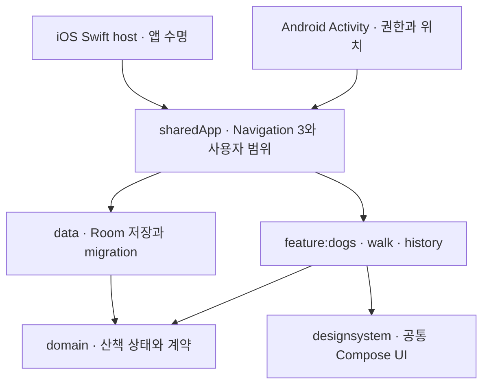

# 따라오개: Android 앱의 Kotlin Multiplatform 마이그레이션

[원본 따라오개](https://github.com/nbc-final-team2/ddaraogae)는 반려견 산책을 기록하는 Android 팀 프로젝트입니다. 이 저장소는 그 앱의 **반려견 등록 → 산책 시작·재개·종료 → 거리·경로 저장 → 기록 열기** 흐름을 Android와 iOS에서 실행할 수 있도록 다시 구성한 포트폴리오입니다. 원본은 팀 공동 작업이며, 이 저장소는 기능 경계와 데이터 수명, 공통 UI, 플랫폼 연결을 별도로 설계한 마이그레이션입니다.

홈·산책·이력·완료 화면은 원본의 회색 바탕, 갈색 액션, 반려견·그래프·도장·날씨 구획, 지도 중심 산책과 하단 조작부를 기준으로 재구성했습니다. Android View XML과 Naver Map Fragment는 iOS에서 실행할 수 없으므로 Compose Multiplatform으로 다시 그렸습니다. 원본의 공개 반려견 로고와 **고정 샘플 지도**는 출처를 밝히고 재사용했습니다. 이 지도는 현재 위치와 지리적으로 맞지 않습니다. 기록 상세의 선은 저장한 좌표의 **상대 이동선**입니다.

## 직접 실행

JDK 17, Android SDK 36/Build Tools 35 또는 Xcode 26과 iPhone Simulator가 필요합니다. 터미널에서 빌드할 때는 `ANDROID_HOME`을 설치된 Android SDK 경로로 설정하세요. Firebase 계정, 서명 키와 API 키는 로컬 시연에 필요하지 않습니다.

Android Studio에서 `androidApp`을 실행하거나:

```sh
./gradlew :androidApp:assembleDebug
adb install -r androidApp/build/outputs/apk/debug/androidApp-debug.apk
```

iOS에서는:

```sh
./gradlew :sharedApp:linkDebugFrameworkIosSimulatorArm64
open iosApp/iosApp.xcodeproj
```

Xcode에서 `Ddaraogae` scheme과 iPhone Simulator를 선택합니다. 두 플랫폼 모두 **반려견 이름 등록 → 하단 산책 탭 → 산책 시작 → 산책 마치기 → 산책 기록 보기** 순서로 확인합니다. 산책 중 홈으로 나갔다 돌아오거나 앱을 다시 열어 중단·재개와 저장된 기록을 볼 수 있습니다. Android는 앱 화면이 열려 있고 위치 권한이 있을 때 실제 위치 콜백을 기록합니다. iOS 제품 빌드는 현재 시간·기록만 저장하며 실제 위치는 수집하지 않습니다.

| 기능 | Android | iOS |
|---|---|---|
| 반려견 이름 1개 등록·수정 | 로컬 Room | 공통 Room |
| 산책 시작·중단/재개·종료, 재실행 복원 | 지원 | 지원 |
| 목록·상세·상대 이동선 | 지원 | 기록/화면 지원 |
| 실제 foreground GPS·거리 | 지원 | 미구현 |
| 합성 경로 시연 | 일반 제품에는 없음 | Debug scenario 전용 DB, 화면에 표기 |
| 로그인·클라우드 동기화·배경 추적·실시간 지도 | 미구현 | 미구현 |

iOS의 합성 경로는 `-Pddaraogae.scenarios=true`로 별도 프레임워크를 만들고 Xcode의 `DDARAOGAE_SCENARIOS` 조건과 `--demo-route` 시작 인자를 사용할 때만 나옵니다. `walks-demo.db`를 제품용 `walks.db`와 분리했고 Release에서는 합성 데이터 진입점을 검사로 배제합니다. 이는 실제 GPS 시연이 아닙니다.

## 화면과 검증 증거

- [Android 홈 실제 에뮬레이터](docs/evidence/submission/android-home.png) · [Android 위치 수집 중](docs/evidence/submission/android-gps-walk.png) · [Android 저장된 기록](docs/evidence/submission/android-record.png)
- [iOS 시뮬레이터 로컬 기록](docs/evidence/submission/ios-record.png) · [Android 조작 영상](docs/evidence/submission/android-demo.mp4)
- [Android/iOS 화면 상태 표본](docs/evidence/M05/)은 개발용 예시 데이터를 쓰는 **시나리오 UI**입니다. 제품 계정·실제 GPS 증거로 해석하지 않습니다.
- [2쪽 기술 포트폴리오 PDF](output/pdf/ddaraogae-kmp-portfolio.pdf)

Android 화면의 26m 예시는 에뮬레이터에 좌표를 주입해 받은 foreground 위치 콜백 결과입니다. 야외 측정, 실기기 검증이나 TestFlight 배포를 뜻하지 않습니다.

## 설계와 의사결정



8개 Gradle 모듈과 iOS Xcode host를 사용합니다. `domain`은 Android·Compose·Firebase·Room에 의존하지 않고, `feature`끼리는 직접 의존하지 않습니다. Koin 생성자 주입으로 사용자 범위를 조립해 화면 이동 뒤에도 산책 수명이 남습니다. Room v1→v4 migration은 과거 기록을 보존하며 좌표와 거리 업데이트를 한 트랜잭션으로 처리합니다. 늦은 위치 콜백은 산책 ID, 재개 구간, 구간 시작 시각으로 거릅니다.

결정 이유와 대안은 [마감 범위 ADR](docs/adr/010-deadline-local-core.md), [원본 UI 충실도 ADR](docs/adr/011-original-ui-fidelity.md), [개발 기록](docs/devlogs/submission-20261011.md)에 남겼습니다. [독립 리뷰](docs/reviews/submission-20261010.md)는 발견한 두 결함과 수정·미재승인 상태를 구분합니다.

## 재현 가능한 검사

```sh
python3 scripts/run_platform_checks.py kmp --ticket M05
python3 scripts/run_platform_checks.py android --ticket M05 --scenarios
python3 scripts/run_platform_checks.py swift --ticket M05 --scenarios
python3 scripts/collect_scenario_screens.py
python3 scripts/run_platform_checks.py android --ticket M05
python3 scripts/run_platform_checks.py swift --ticket M05
python3 scripts/check_scenario_release.py
python3 scripts/check_swift_api.py
python3 scripts/architecture_check.py
```

Android 검사는 AVD, iOS 검사는 iPhone Simulator가 설치돼 있어야 합니다. 실행기는 원본 JUnit XML과 xcresult를 확인하며 0개·누락·skip·실패를 완료로 세지 않습니다. 시나리오 화면은 각 플랫폼 39장을 생성하고, Release 검사는 Debug 합성 경로가 빠졌는지 확인합니다. 현재 실행 결과와 남은 제한은 [개발 기록](docs/devlogs/submission-20261011.md)에 적었습니다.

이 저장소는 지원용 **진행 중인 로컬 핵심 흐름**입니다. 실제 iOS GPS, 로그인·동기화, 여러 반려견과 사진, 지도 타일·날씨·도장 서비스, signed APK/TestFlight 설치와 양 플랫폼 실기기 검증은 아직 완료하지 않았습니다. 코드가 컴파일됐다는 사실을 그 기능들의 배포 검증으로 표시하지 않습니다.
