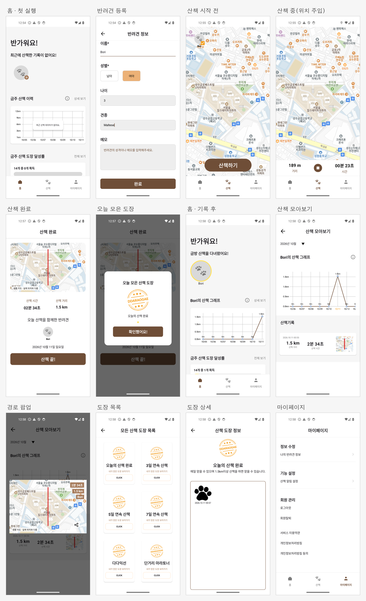
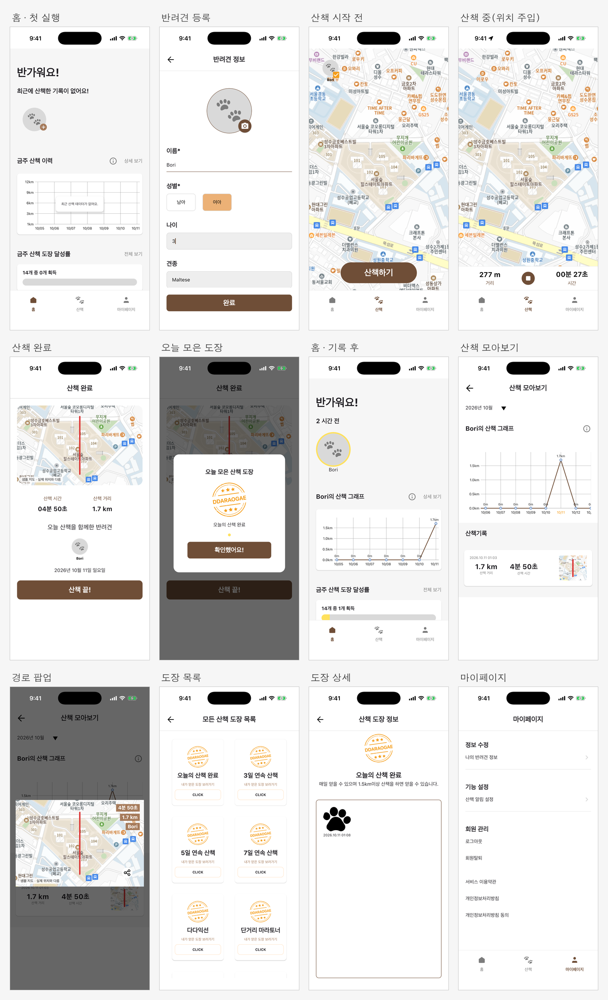

# 따라오개 · Kotlin Multiplatform 마이그레이션

반려견 산책 기록 앱 **따라오개**([원본 Android 팀 프로젝트](https://github.com/nbc-final-team2/ddaraogae))를 Kotlin Multiplatform과 Compose Multiplatform으로 다시 만든 포트폴리오입니다. 원본의 홈·산책·산책 완료·산책 모아보기·도장·마이페이지·반려견·알림 화면을 **같은 공통 Compose 코드로 Android와 iOS에 이식**했고, 산책 기록(위치·거리·경로)과 도장·그래프는 두 플랫폼에서 실제로 동작합니다. 실제 지도, 로그인, 날씨, 알림 예약, 클라우드 동기화는 **아직 연결하지 않았습니다.** 화면별 같은 점·다른 점은 [패리티 표](docs/ui-parity.md), 남은 일은 [현황표](docs/migration-gap-audit.md)에 그대로 적었습니다.

채용 지원서 첨부용 [2쪽 포트폴리오 PDF](output/pdf/ddaraogae-kmp-portfolio.pdf)도 제공합니다.

## 화면

아래는 모두 **일반 제품 빌드**(`개발용 예시 데이터` 배너가 없는 빌드)를 Android 에뮬레이터(Pixel 4a, API 34)와 iPhone 17 Pro Simulator(iOS 26)에서 실행한 화면입니다. 위치는 에뮬레이터/시뮬레이터에 주입한 좌표이며 야외 실측이나 실기기 결과가 아닙니다. 산책 화면의 지도는 원본에 들어 있던 **고정 샘플 이미지**라 현재 위치와 맞지 않고, 경로는 그 위에 상대 선으로 그려지며 화면에 그렇게 표시됩니다.

**Android**



**iOS**



조작 영상(처음 실행 → 반려견 등록 → 주입 좌표로 산책 → 도장 → 이력·마이페이지, 기다리는 구간은 빠르게 돌렸습니다): [Android 68초](docs/evidence/submission/android-demo.mp4) · [iOS 90초](docs/evidence/submission/ios-demo.mp4). 화면 하나씩 보려면 [`docs/evidence/submission/screens/`](docs/evidence/submission/screens)에 플랫폼별 13장이 있습니다. 원본 앱 화면은 이 저장소에 복사하지 않았으니 [원본 저장소](https://github.com/nbc-final-team2/ddaraogae)에서 비교해 주세요.

최종 수정 후 Android 제품 빌드의 [산책 화면과 샘플 지도 안내](docs/evidence/submission/android-walk-map-notice.png)도 별도로 확인했습니다.

## 지금 되는 것과 안 되는 것

| 기능 | Android | iOS |
|---|---|---|
| 홈(그래프·"N 시간 전"·도장 달성률), 산책 모아보기(월 선택·경로 팝업), 도장 목록·상세 | 로컬 산책 이력에서 계산, 동작 | 동일 |
| 반려견 이름·성별·나이·견종·메모 저장·수정·삭제 | Room, 동작(**1마리**) | 동일 |
| 산책 시작·종료·재실행 복원, 산책 완료와 도장 다이얼로그 | 동작 | 동작 |
| 실제 위치·거리·경로 | **앱이 열린 동안** | **앱이 열린 동안**(Core Location) |
| 로그인·회원가입 화면 | UI만(제품 흐름에는 없음) | UI만 |
| 지도 타일, 날씨·미세먼지, 알림 예약, 경로 공유, 사진, 약관 본문 | 미연결("연결 전" 표시) | 미연결 |
| 로그인·클라우드 동기화·백그라운드 위치·signed 배포 | 미구현 | 미구현 |

## 빠른 시연

**빌드 없이 설치:** [시연용 Release](https://github.com/BettorBoom/ddaraogae-kmp-portfolio/releases/tag/v0.1.0-demo-20261011)에서 `ddaraogae-debug.apk`(Android) 또는 `Ddaraogae-ios-simulator.app.zip`(Mac의 iPhone Simulator 전용)을 받고 같은 페이지의 `SHA256SUMS.txt`로 무결성을 확인합니다. Android에서는 파일을 기기로 옮겨 열거나 `adb install -r ddaraogae-debug.apk`로 설치합니다. iOS zip은 아래처럼 Simulator에 설치할 수 있습니다. **둘 다 개발용 빌드**이며 TestFlight·App Store·실기기 iOS 설치 파일이 아닙니다.

```sh
unzip -q Ddaraogae-ios-simulator.app.zip -d /tmp/ddaraogae-ios-demo
xcrun simctl boot "iPhone 17 Pro" 2>/dev/null; open -a Simulator
xcrun simctl install booted /tmp/ddaraogae-ios-demo/Ddaraogae.app
xcrun simctl launch booted dev.ddaraogae.preview
```

**소스에서 빌드:** 필요한 것: JDK 17, Android SDK(compileSdk 36, `local.properties`의 `sdk.dir`), iOS는 Xcode 26과 iPhone Simulator(Apple Silicon). 새 Firebase 계정이나 서명 비밀번호는 **필요 없습니다.** 앱은 Android minSdk 28·iOS 16 이상입니다.

**Android**: 에뮬레이터(또는 기기)를 켜고 디버그 APK를 설치합니다.

```sh
./gradlew :androidApp:assembleDebug
adb install -r androidApp/build/outputs/apk/debug/androidApp-debug.apk
adb shell pm grant dev.ddaraogae.app android.permission.ACCESS_FINE_LOCATION   # 선택: 권한 대화상자 생략
adb shell am start -n dev.ddaraogae.app/.MainActivity
```

**iOS Simulator**: 공용 프레임워크를 만든 뒤 Xcode에서 `iosApp/iosApp.xcodeproj`의 `Ddaraogae` scheme을 iPhone Simulator에서 실행하거나 아래처럼 명령줄로 설치합니다.

```sh
./gradlew :sharedApp:linkDebugFrameworkIosSimulatorArm64
xcodebuild -project iosApp/iosApp.xcodeproj -scheme Ddaraogae -configuration Debug \
  -destination 'platform=iOS Simulator,name=iPhone 17 Pro' -derivedDataPath build/ios build
xcrun simctl boot "iPhone 17 Pro" 2>/dev/null; open -a Simulator
xcrun simctl install booted build/ios/Build/Products/Debug-iphonesimulator/Ddaraogae.app
xcrun simctl privacy booted grant location dev.ddaraogae.preview   # 선택
xcrun simctl launch booted dev.ddaraogae.preview
```

앱에서 **홈의 반려견 추가 → 이름·성별 입력 → 완료 → 산책 탭 → 산책하기 → 정지 버튼 → 산책 끝!** 순서로 진행하면 홈 그래프, "금방 산책을 다녀왔어요!", 산책 모아보기가 채워집니다. 거리와 도장까지 보려면 산책 중에 좌표를 주입합니다. 1.5km 이상이면 "오늘의 산책 완료" 도장이 나옵니다. 아래 명령은 영상과 같은 값이며 개발용 좌표입니다(실기기 측정이 아닙니다). 앱은 초당 12m를 넘는 이동을 잡음으로 버리므로 11m/s 안쪽으로 주입합니다.

```sh
# Android 에뮬레이터: 산책하기를 누른 뒤 실행. 초당 약 11m씩 북쪽으로 1.5km (경도, 위도 순서)
for i in $(seq 0 140); do adb emu geo fix 127.0000 $(python3 -c "print(f'{37.5 + $i * 0.0001:.5f}')"); sleep 1; done

# iPhone Simulator: 산책하기를 누르기 전에 첫 좌표를 두고, 누른 뒤 약 1.7km 경로를 흘려보냅니다
xcrun simctl location booted set 37.5000,127.0000
xcrun simctl location booted start --speed=11 --interval=1 37.5000,127.0000 37.5153,127.0000
```

iOS 경로 주입은 약 2분 35초 걸립니다. **경로 이동이 끝나고 앱에서 산책을 종료한 다음에만** `xcrun simctl location booted clear`로 주입 좌표를 정리하세요.

## 설계와 검증

`domain`은 산책·반려견 계약과 이력에서 계산하는 도장·통계·표기 규칙을, `data`는 Room v1→v5 보존 migration과 좌표·시간의 원자적 저장을 맡습니다. 기능은 `feature:walk`(산책·완료·도장 다이얼로그), `dogs`, `history`, `stamp`, `mypage`, `auth`(UI만)로 나뉘고 `designsystem`이 원본 색·치수·차트·공통 컴포넌트를 가집니다. `sharedApp`이 Navigation 3·Koin 사용자 범위를 조립하며 Android Activity와 iOS Swift host는 권한·foreground 위치 callback·앱 수명을 연결합니다. 도장·그래프·"N 시간 전"은 저장하지 않고 로컬 산책 이력에서 매번 계산하므로 앱을 다시 열어도 같은 값입니다. 결정과 포기한 대안은 [ADR-010](docs/adr/010-deadline-local-core.md) · [ADR-011](docs/adr/011-original-ui-fidelity.md) · [ADR-012](docs/adr/012-ios-foreground-location.md) · [ADR-013](docs/adr/013-original-ui-port-scope.md)에, 실패와 수정은 [devlog](docs/devlogs/M10.md)에 있습니다.

```sh
python3 scripts/architecture_check.py
python3 scripts/run_platform_checks.py kmp --ticket M05 --scenarios
python3 scripts/run_platform_checks.py android --ticket M05 --scenarios
python3 scripts/run_platform_checks.py swift --ticket M05 --scenarios
python3 scripts/collect_scenario_screens.py
python3 scripts/run_platform_checks.py android --ticket M05
python3 scripts/run_platform_checks.py swift --ticket M05
python3 scripts/run_platform_checks.py swift --ticket M05 --location
python3 scripts/check_swift_api.py
python3 scripts/check_scenario_release.py
```

각 runner는 JUnit XML과 xcresult 원본을 보관하고 테스트 0개·누락·skip·실패를 완료로 세지 않습니다. 위 명령 가운데 Android·iOS 항목은 에뮬레이터와 iPhone Simulator가 있어야 합니다. GitHub Actions가 자동으로 도는 검사는 JVM 테스트와 모듈 경계 검사뿐이고, Android·iOS 화면 검사는 이 명령으로 에뮬레이터/시뮬레이터에서 직접 실행한 결과입니다.

### 2026-10-11 로컬 검증 결과

원본 화면 전체 이식을 마친 소스에서 아래를 실행했고 모두 실패·skip 없이 통과했습니다.

| 검사 | 결과 |
|---|---|
| 공통 Kotlin 테스트(JVM + iOS Simulator) | 86개 통과 |
| Android 시나리오 계측(상태·다크·2배 글씨·넘침·재렌더) | 5개 통과 |
| iOS 시나리오 XCTest | 7개 통과 |
| 시나리오 화면 캡처 | Android 57장 + iOS 57장, 누락 0 |
| Android 제품 빌드 계측 | 2개 통과 |
| iOS 제품 빌드 XCTest | 2개 통과 |
| iOS Core Location 좌표 주입 | 1개 통과 |
| Release 가드 | 시나리오 fixture 유출 0, 거부 guard 3개 |
| Swift 공개 API 기준선·모듈 경계 | 일치·통과 |

이 수치는 Android 에뮬레이터(Pixel 4a, API 34)와 iPhone 17 Pro Simulator(iOS 26)의 로컬 실행 결과입니다. 실기기, 야외 위치, signed 빌드, 스토어 배포는 포함하지 않습니다. [독립 Sol 리뷰](docs/reviews/submission-20261011-sol.md)는 자정 산책 도장·샘플 지도 안내·iOS 시연 명령을 지적했고 수정 소스를 승인했습니다. 리뷰어가 런타임 테스트를 직접 실행한 것은 아닙니다. 스크린샷과 영상은 위 시나리오 캡처가 아니라 일반 제품 빌드를 직접 조작해 찍었습니다.

## 원본 팀 프로젝트와의 관계

원본 따라오개는 팀 프로젝트(nbc-final-team2)입니다. 이 저장소는 Android View XML과 Naver Map 화면을 복사한 것이 아니라 화면의 문구·치수·색·동작 규칙을 공통 Compose와 Kotlin 도메인으로 다시 구현한 작업이며, 원본 저장소의 공개 앱 아이콘·아이콘 벡터·도장 이미지·샘플 지도 자산을 재사용했습니다. 원본 약관·개인정보 처리방침 본문과 SF Pro 글꼴은 가져오지 않았습니다.

## 남은 범위

이것은 진행 중인 포트폴리오입니다. 실제 지도(Android Naver Map·iOS MapKit), Firebase 인증과 계정별 전환, 반려견 여러 마리·사진, 양 플랫폼 백그라운드 추적, 날씨·알림 예약, 서버 동기화·충돌/재시도, signed APK·TestFlight·실기기 검증은 별도 작업입니다. 완료와 미완료의 구분은 [현황표](docs/migration-gap-audit.md)와 [ROADMAP](ROADMAP.md)에 있습니다.
